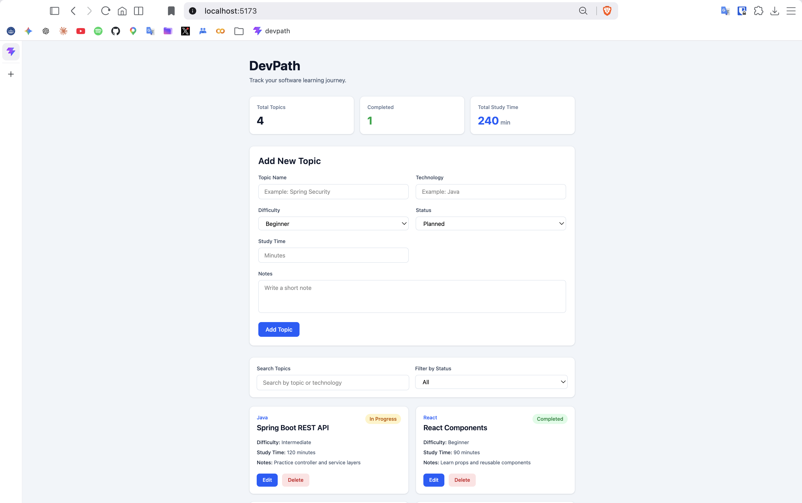

# DevPath

DevPath is a React-based software learning tracker that helps users organize and monitor the topics they are studying.

## Features

- Add new learning topics
- List all saved topics
- Edit existing topics
- Delete topics with confirmation
- Search by topic name or technology
- Filter topics by status
- Track total topics, completed topics, and total study time
- Store data in LocalStorage
- Responsive design

## Technologies

- React
- Vite
- JavaScript
- Tailwind CSS
- LocalStorage
- ESLint

## Project Structure

```text
src/
├── components/
│   ├── TopicCard.jsx
│   └── TopicForm.jsx
├── App.jsx
├── index.css
└── main.jsx
```

## Screenshot



## Live Demo

[Open DevPath](https://zafermert-devpath.netlify.app)